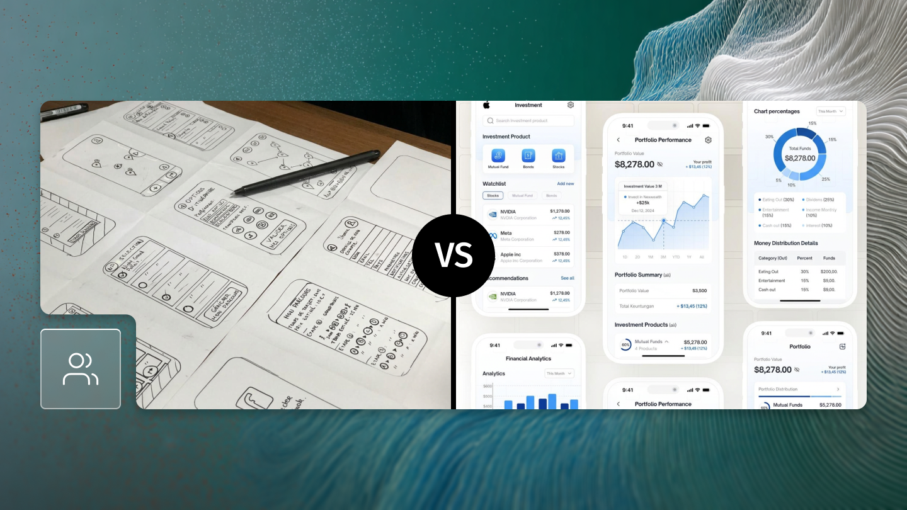
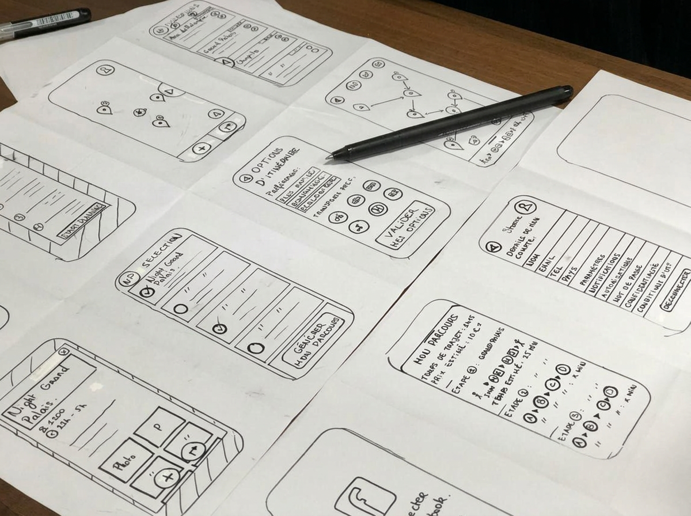
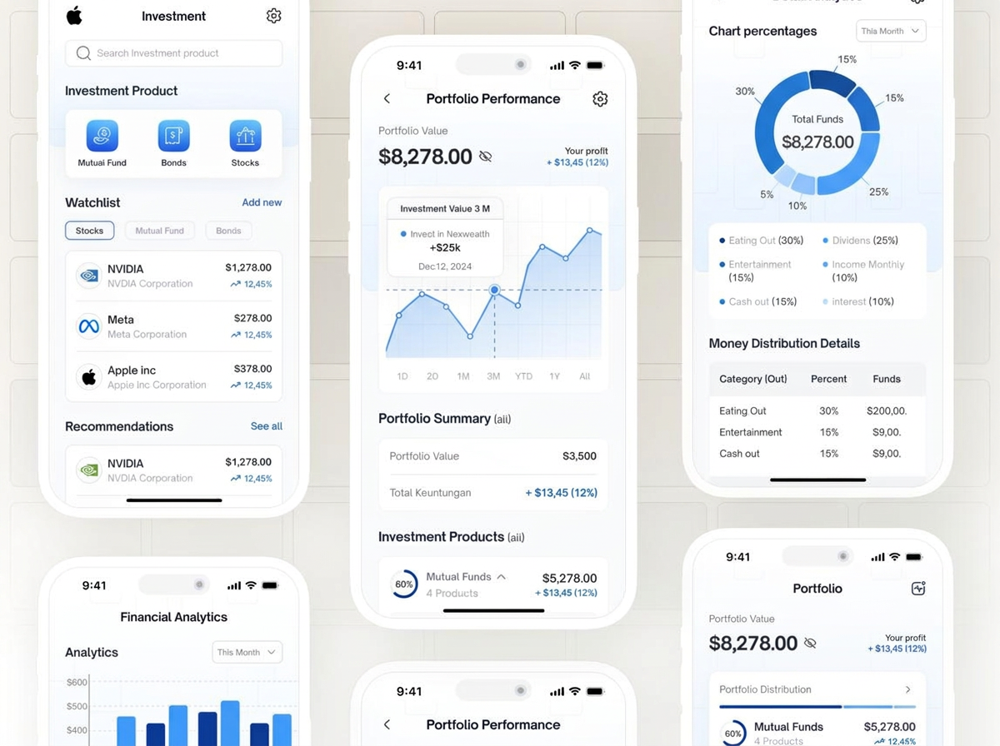

# AI Prototyping: More output doesn't mean more value (#16)

## Motivation

Everyone can build now. But does that mean we're building better products?

AI has dramatically reduced the effort required to turn an idea into a working prototype. What once took designers hours or even days can now happen in minutes. Product managers, developers, and stakeholders can create interactive interfaces without writing a single line of code or opening a design tool. - Sounds great, right?

But there's a catch. Just because we can build something faster doesn't mean we understand what we're building. Prototyping has always been about more than creating interfaces. It's a communication tool. A way to turn assumptions into something tangible, challenge ideas, and build a shared understanding before committing resources. AI changes how quickly we can create prototypes. It doesn't change why we need them.

---

## Challenge

When everything looks finished, nothing gets questioned. Traditionally, low-fidelity wireframes helped teams explore ideas without getting distracted by visual details. They were intentionally rough, cheap to produce, and easy to throw away. High-fidelity prototypes served a different purpose. They helped validate detailed interactions, usability, and the overall experience.

Both approaches have their place:

The problem is that AI increasingly skips the rough part. We describe an idea, and seconds later, we get a polished interface with charts, buttons, colors, and interactions.

It looks convincing. Sometimes too convincing. Stakeholders assume the concept is already validated. Teams discuss colors instead of user needs. Developers start questioning where the data comes from, while others have already fallen in love with the solution.

**And suddenly, the time we saved creating the prototype is spent explaining, reviewing, and rebuilding it.** A polished interface can create the illusion of progress without actually reducing uncertainty.

---

## The journey

#### Bringing low fidelity back with AI

I recently experimented with a different approach. Instead of asking AI to create yet another polished interface, I wanted to see whether it could help us explore concepts while staying close to our existing products.

The idea was simple: create a reusable low-fidelity design system based on an existing application. Using an AI assistant with browser access, I analyzed the application's layout, components, navigation, and interaction patterns. From that information, I generated a simplified design system that preserved the product's structure without its visual complexity. Then came the first experiment. I asked AI to extend an existing portfolio interface with the ability to buy and sell assets. Nothing particularly sophisticated. Just a short prompt with some context.

The result surprised me (LLM also got an huge update the last months/weeks). It created an interactive workflow with familiar navigation, a side panel, order details, confirmation steps, and feedback states. Not perfect, of course, but good enough to start a meaningful conversation. And that was the point. We didn't need a finished interface. We needed something everyone could understand, challenge, and improve.

---

## Solution approach

#### From workshop to working prototype

The next experiment went a little further. We had conducted a workshop exploring new user groups, different needs, and potential features. The outcome was familiar: a FigJam board filled with sticky notes, questions, assumptions, and ideas.

Instead of manually translating everything into requirements and wireframes, I used the board itself as context for AI.

Proposed illustration: A repeatable workflow that keeps collaboration and problem understanding ahead of prototype generation. Within a short time, AI produced several interactive concepts exploring different questions.

- What should a portfolio overview look like for someone with relatively simple investments compared to someone managing multiple asset classes?
- Should the homepage focus on total wealth or personal financial goals? What could onboarding look like for a first-time user?

These weren't final solutions. They were alternatives we could compare. Even better, the prototypes included context from our workshop: assumptions, questions, and the reasoning behind particular concepts. Suddenly, the prototype wasn't just showing a possible solution. It was also explaining why we were exploring it. That's where things became interesting.

---

## Learnings

#### More prototypes don't automatically mean better decisions

The technical possibilities are impressive. But the real challenge isn't generating interfaces anymore. It's managing the decisions around them.

When everyone can create prototypes, who decides which direction to pursue? Who ensures consistency across products? And how do we prevent different teams from solving the same problem in completely different ways?

These questions become even more important as AI makes production cheaper. The temptation is to skip discussions and jump straight into building. But collaboration isn't overhead. It's how we uncover conflicting assumptions, technical constraints, and opportunities we might otherwise miss.

A developer might identify an existing capability that saves weeks of implementation. A designer might question whether the proposed workflow makes sense. A product manager might challenge whether we're solving the right problem in the first place.

AI can help explore possible answers. It doesn't replace those conversations. More output doesn't mean more alignment. And more alignment doesn't happen without communication.

---

## What's next?

There is enormous potential in connecting AI to the knowledge organizations already have: research, product documentation, design systems, technical constraints, and decisions made across teams.

Being able to prototype a new feature while AI already understands the product's patterns, known user problems, and existing technical capabilities.

The next challenge isn't simply making AI better at creating interfaces. It's creating a way of working where teams can use those capabilities without losing the shared understanding that makes good products possible.

Because in the end, AI can help us build a solution. But we still have to understand the problem worth solving.

---

### Resources

- [The people ARE the process](https://productpicnic.beehiiv.com/p/the-people-are-the-process)
- [AI Can Build the Solution... You Still Have to Design the Problem](https://www.oneknightinproduct.com/pavel-samsonov/?utm_campaign=ai-is-not-a-substitute-for-knowing-how-to-run-software-projects&utm_medium=referral&utm_source=productpicnic.beehiiv.com)
