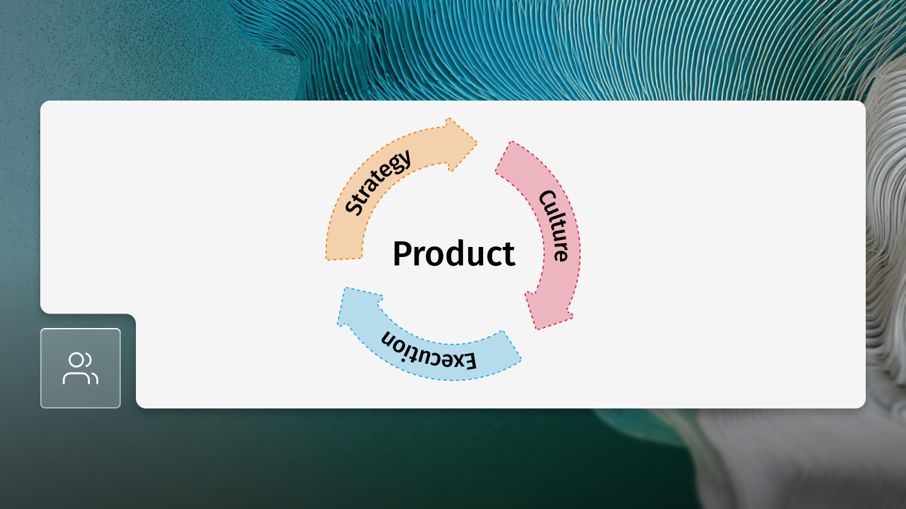

# How branding builds organizations that build great products (#15)

## Motivation

Great ideas don’t fail. Systems do. Great ideas are everywhere. They exist in every team, every department, and every hallway conversation. What’s rare is an environment that allows them to grow. Most companies don’t struggle because they lack creativity. They struggle because their systems make it impossible for creativity to take root.  In siloed organizations, even the best ideas die quietly. Teams work in isolation. Priorities compete. Ownership is unclear. People spend more energy navigating friction than shaping progress. Over time, this slow, invisible friction drains value from the entire company.

*\*Note: I was heavily inspired by Thiago Costa on this, so full credit to him. This is just my own version, mixed with my experience and perspective.*

---

## Challenge

Most rebrands miss this completely. They change colors, tweak logos, rewrite taglines, and call it transformation. But nothing meaningful shifts underneath. The same processes, incentives, and power structures remain. The same culture that produced the old brand keeps running the new one.

> “Every system is perfectly designed to achieve the results it gets.”
>
> <cite>— Dr. W. Edwards Deming</cite>

The most important product a company ever builds is itself. A brand isn’t decoration. It’s design. Not the paint on the walls, but the blueprint of the house, the structure that shapes how you build, what you build, and why it matters. Real branding starts long before the visuals. It begins by redesigning the company itself: **the people, the principles, and the systems that bring the work to life.** Because in the end, every brand is just a reflection of how a company truly works.  **Your company is the first product** Before a company produces anything for the market, it must first produce itself. A company is a product: a living system that turns creative inputs like people, ideas, and technology into valuable outputs such as products, experiences, and reputation. If that system is inconsistent, no product can be consistent.**A brand is not an outcome** A brand isn’t the result of marketing or design activities. It’s not what you get after you’ve built products, launched campaigns, or created visuals. A brand is the system that makes all those things coherent. It’s the shared logic that connects:

- Why you exist (strategy)
- How you behave (culture)
- What you deliver (execution)

If those elements aren’t aligned, if your values say one thing, your strategy pursues another, and your teams act on something else entirely, no amount of design or communication can hold it together. Every new project becomes a disconnected campaign instead of part of a continuous story.A real brand functions like an operating system. It defines how ideas move through the organization, how decisions are made, and how feedback from customers loops back into culture and strategy. When it works, it creates alignment, focus, and momentum. Everything starts reinforcing everything else.  **In short:**

- Brand ≠ logo, tone, or campaign
- Brand = system of alignment between strategy, culture, and execution

That’s why branding isn’t something that happens at the end of the process. It’s the framework that shapes every process from the inside out.

---

### Case study: Chrono24 - A brand built through clarity

When Chrono24 set out to become the world’s leading marketplace for luxury watches, they didn’t start with a perfect logo or a new name. In fact, they almost changed their name, worried that “24” sounded too cheap for a luxury brand.  What they realized, and what ultimately powered their growth to over €1 billion in transactions, was that brand strength doesn’t come from labels, it comes from behavior. Instead of obsessing over external perception, they focused on aligning three internal systems:  

- **Strategy:** Clarifying who they served and how they were different, not as messaging, but as an organizing principle.
- **Culture:** Ensuring every team, from product to HR, understood and lived those same principles.
- **Execution:** Creating clarity in decision-making, from the founders to every user touchpoint.  

It took several failed attempts, multiple agency collaborations, and years of iteration to get there. Their eventual success didn’t come from a better color scheme. It came from realizing that branding was their most critical internal system, not their marketing output. As founders Tim and Philipp Stracke put it, “We had to steer the brand, not just let it run. It took us years, and several wrong turns, to truly make it ours.”  

FYI: I worked at Chrono24 later in their journey, once the system was already in motion, I saw firsthand how much that clarity helped streamline UX work and made it easier to focus on what really mattered.  

---

### Culture is the result, not the ritual

Too many leadership teams mistake culture for the rituals that decorate it: the slogans, retreats, and office perks. But culture isn’t what a company says about itself. It’s what it consistently does.  

> "Companies themselves are a kind of product, systems that process inputs into more valuable outputs."<cite>— Thiago Costa</cite>

Culture is the code that runs that system. It’s the force that shapes how work gets done every day. When what happens inside doesn’t match the story told outside, culture and brand collide, and no amount of design can repair that disconnect.

### Branding as the company’s operating system

Real branding connects three feedback loops:

1. Strategy → Culture: What you choose to stand for
2. Culture → Execution: How that choice shapes behavior
3. Execution → Product: How behavior manifests in what you build and sell  

When these loops reinforce one another, brand becomes the company’s most scalable system, an invisible engine that compounds trust, talent, and traction over time. When they don’t, even the most beautiful design system will collapse under strategic misalignment.

---

## Conclusion

Questions every leader should ask before rebranding

1. What problem is our current brand system failing to solve: aesthetic or structural?
2. Where is there friction between our culture, strategy, and customer experience?
3. Are we designing visuals, or designing a company that can consistently deliver value?
4. If our company is a product, what version are we currently shipping, and what needs to be rebuilt?

Because in the end, branding isn’t about looking different. It’s about operating differently, about building an organization capable of creating products that consistently express who it really is.  

> “Any organization that designs a system will produce a design whose structure mirrors the organization’s communication patterns.”<cite>— Conway’s Law</cite>

 In today’s UX reality, messy teams and unclear ownership almost always result in fragmented user experiences. The quality of what users feel on the outside reflects the clarity of what happens on the inside. Your brand works the same way. You don’t just get the brand you design. You get the brand your organization enables and ultimately, the one it deserves.

---

**Resources**

- [Markenaufbau Masterclass: Learnings von Chrono24 | Von 0 auf 1 Milliarde - mit Tim und Philipp Stracke, Chrono24](<https://open.spotify.com/episode/3Vll977SeBcAx0yrYnJjx2>)
- [Culture as a Product: How HubSpot Built its Famed Startup Culture](<https://underscore.vc/resources/culture-as-product-hubspot-culture/>)
- [Why we built a company before building a product - Creators of Fey.com. Acquired by Wealthsimple](<https://web.archive.org/web/20250125032411/https://www.narative.co/articles/why-we-built-a-company-before-building-a-product/>)
- [brand-trust.de](<https://www.brand-trust.de/de/>)
