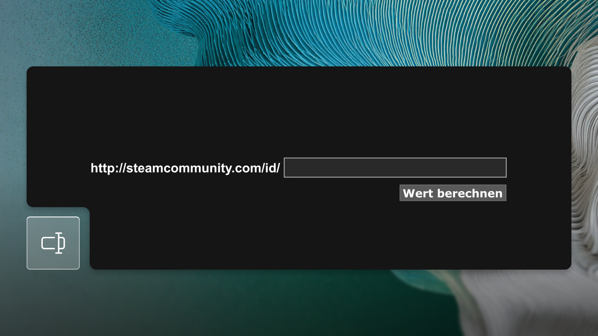

# The challenge that comes with an input field (#1)

## Motivation

An article about the use of an input field which caught my attention. In this case the Amazon search bar. It simply demonstrates that even to this day people continue to misuse and misunderstand interfaces, contrary to our expectations.

The article can be found here: [Article](<https://shkspr.mobi/blog/2021/10/every-search-bar-looks-like-a-url-bar-to-users/>) — **TLDR:** People mix up the search bar with the browser address bar and enter complete URLs for example.

The challenge of users misunderstanding input fields is not unique to any one platform; we encountered this issue with our private project called [SteamCalculator](<https://steamcalculator.com/>) as well. What is SteamCalculator? It’s a web application, which allows you to calculate the approximate value of a given Steam account. It first went online on hl-portal.de in June 2008 and became popular very soon and was even featured on [PC Games](<https://www.pcgames.de/Valve-Software-Firma-15833/News/So-viel-ist-Ihr-Steam-Account-wert-Steam-Calculator-gestartet-658301/>).

: The first version of the calculator.")

---

## Challenge

Lets have a closer look. We will ignore the captcha input field from the screenshot above for now:

: Users had to complete the Steam profile URL in the form.")

The input field displayed above seems to be straight forward, right? Just complete the URL by adding your Steam ID at the end. There are some assumptions you can draw, like:

 **1. Will they know to complete the URL?** Even thought it looks “technical” it actually works quite well. Also Paypal.me for instance lets you define the person and amount you wish to send via an URL. The URL would look like: paypal.me/person/amount

**2. How do they know what to enter in the input field?** Yes, it is still a problem to this day. We basically have written a brief introduction for it.

**3. Where can they find their Steam ID?** See point number two.

**4. Will people just start typing in random stuff aka trial and error?** A lot of magic happens in the background to at least minimize the error rate for the user. Things people type in:

- ` E-mail address  `
- ` Profile ID  `
- ` Custom URL  `
- ` Whole Steam profile URL  `
- ` Steam ID  `
- ` Steam ID 2  `
- `Steam ID 3`

### So we have two ways to help the user

Make the UI clean, clear and as basic as possible and provide help when needed so the user always has a fallback. Also try to correct their errors on the fly. Put simply, all previously mentioned input options should function to the fullest extent technically feasible.

 As interfaces and user behavior evolve over time, your product should also adapt accordingly. Lets have a closer look how Steam looked like for example in 2010:

: The profile URL was visible in the client’s Community area.")

The Steam ID can be found in the Steam URL address bar, which is shown under the Community category:

: The address bar shows a numeric profile ID.")

[ ](<https://blog.qrt.de/static/8e653ab5ea894750c30fe47a2b21034a/ee9b7/sc-steam.png>)The Steam ID can be replaced through a custom URL. So instead of having a 17 digit number you can set up a custom URL by using your gamertag for example. As a guideline, we mention both possibilities in the input field. You can also notice that the Steam interface and the URL (from "**/profiles/**” to “**/id/**”) has changed over time:

: The placeholder introduces Steam IDs and custom URLs.")

The most significant change and challenge came on April 11th, 2018, when Steam declared that all their profiles would be set to private by default. As a result, SteamCalculator could no longer process Steam profiles since the required information was no longer publicly accessible. However, users can reverse this by making their profiles public. Additionally, the previously visible Steam’s URL address bar was concealed, necessitating a more detailed instruction from us. Refer to the image below:

The instruction tripled in length and even included a GIF animation due to users struggling to locate the setting despite the guidance. Apart from showing where to find the Steam ID, we also had to illustrate how to reveal the Steam URL address bar and set profiles to public. The process became increasingly complex and cumbersome.

### How we respond and adapt over time

Initial input field of SteamCalculator: (2008 - 2012)

: The first version asked users to complete a profile URL.")
: The simpler form retained the URL prefix and Go action.")

Following a 2016 relaunch, we adopted a minimalistic design, using the input field placeholder to hint at the expected value. However, this method assumes users already know what a Steam ID or custom URL is and where to locate it. We then enhanced the CTA by adding “Enter” to the placeholder. Furthermore, we have inserted a little helper text directly below the input field. The bounce rate has dropped by roughly 35-40 percent. We are also considering putting a clear CTA in the button again:

: A placeholder and helper text explain what users can enter.")
: Adding “Enter” and helper text made the next step clearer.")

> “There will always be users who might use your product not as intended. So, simplify the complexity of your product as much as possible. However, this might make your code more complex to deliver the greatest possible experience to the users - Complexity shifts.”
> <cite>— Tesler’s Law</cite>

We have also looked for alternatives that go beyond the input field. So we have integrated the Steam login. The user now neither needs to know what to enter nor where to find his Steam ID. The only requirement now is that his profile needs to be public.

---

## Current version

: The current design combines manual entry, Steam login, and account statistics.")

The final version? For sure not. We are planning to perform A/B Testing to measure and refine further designs. We may also find another new entry point for the user, which will make it even easier and more convenient for him to calculate his account value.

### Key Takeaways

1. **Clear Instructions**: Provide clear, concise guidance to help users correctly fill input fields.
2. **Iterative Improvement**: Continuously refine design based on user feedback and behavior changes.
3. **Error Minimization**: Implement real-time validation and fallback options to reduce user errors.
4. **User Knowledge Adaptation**: Use placeholders and helper text to guide users unfamiliar with specific terms.
5. **Platform Change Adaptation**: Update instructions and functionality in response to interface changes.
6. **Simplicity and Functionality Balance**: Simplify interfaces without losing essential functionality, even if complex background processes are needed.
7. **Alternative Entry Points**: Provide alternative methods, like Steam login, to simplify user tasks.
8. **Comprehensive User Guidance**: Use detailed guides and visual aids to help users with complex processes.
9. **Continuous Testing**: Conduct A/B testing and gather feedback to refine input field designs.
10. **User-Centered Design**: Focus on understanding and addressing user pain points for higher satisfaction.

### *Edit 05.12.2021
We encountered another shift when users began inputting their friend code, typically used for adding friends on Steam. This led us to prioritize asking for the friend code directly, given its familiarity to users. While the Steam ID helped identify profiles, it wasn't intended for users to locate and share. By focusing on the friend code, we could significantly reduce the written instructions.
